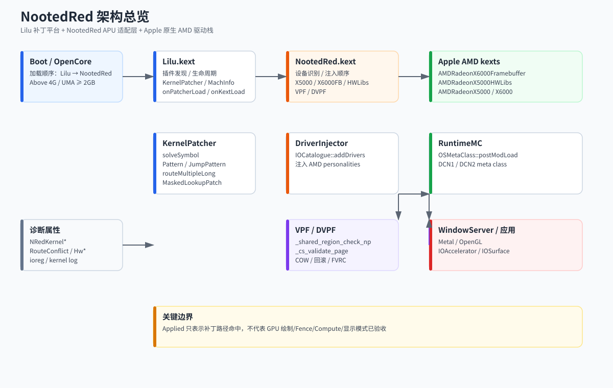
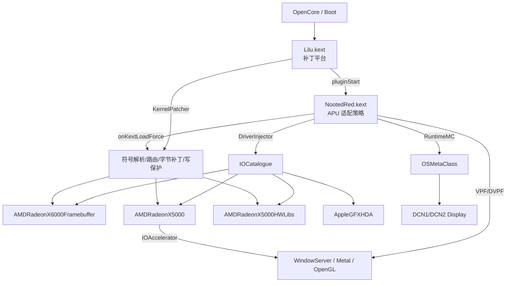
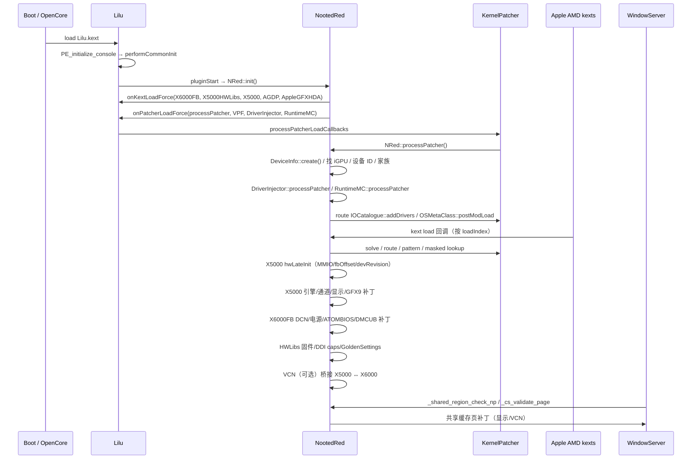
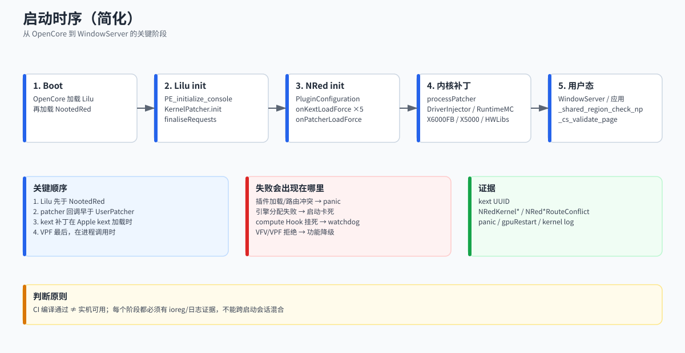
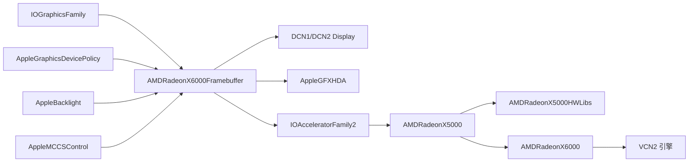
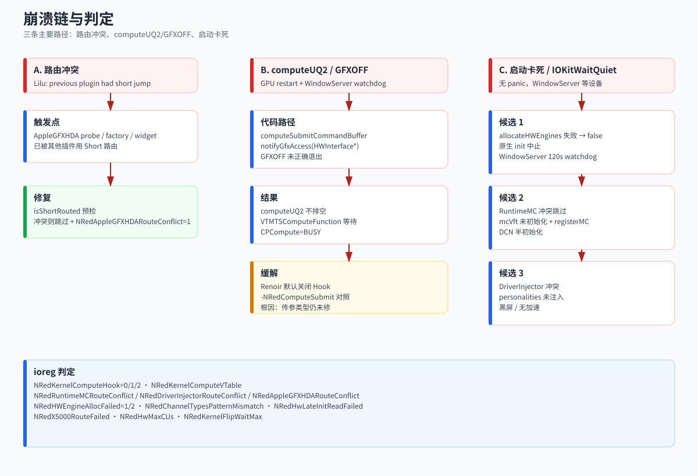

# NootedRed 深度分析报告

> 分析对象：`weixin_47785647/NootedRed-dev`（fork 自 `ChefKissInc/NootedRed`，基线 2026-10-10）
> 代码版本：GitHub `main` 提交 `708ce43`（`2c1a74b` + 本报告/图 + AppleGFXHDA widget 修复；含 compute Hook、Long 路由、冲突检测与诊断加固）
> 目标平台：AMD APU（Raven / Picasso / Renoir / GreenSardine）+ macOS 14/15/26（Darwin 23/24/25），x86_64
> 分析方式：源码静态审计 + CI 产物符号/反汇编 + Lilu 源码对照
>
> 说明：本文区分“代码事实”“运行时推断”“尚未实机验证”。行号基于 `2c1a74b`，后续提交可能变化。
> 配图：`docs/images/nootedred-architecture.svg`、`nootedred-boot-sequence.svg`、`nootedred-crash-chain.svg`
> 报告版本：2026-11-19（汇总 4 个独立子分析：Lilu 机制、AMD 驱动栈、VPF 框架、崩溃链与风险）

---



## 摘要

NootedRed 不是一套独立的 AMD GPU 驱动，而是**夹在 macOS 原生 AMD 驱动与硬件之间的补丁编排层**。它复用 Apple 的 `AMDRadeonX5000`、`AMDRadeonX6000Framebuffer`、`AMDRadeonX5000HWLibs`、`AMDRadeonX6000` 等 kext，通过 Lilu 提供的符号解析、函数路由、字节补丁和内核写保护接口，把这些驱动“骗”到 APU 上工作。

核心结论：

1. **Lilu 是平台，NootedRed 是策略**。Lilu 负责“怎么改内核/kext”，NootedRed 负责“改哪里、改成什么”。
2. NootedRed 的启动分为两条时间线：**内核 kext 加载期**（DriverInjector、RuntimeMC、X5000/X6000FB/HWLibs/AGDP/AppleGFXHDA）和**用户态图形栈加载期**（Metal/OpenGL 共享缓存页补丁，即 VPF/DVPF）。
3. 崩溃不是单点问题，而是“路由/注入/硬件假设”三层叠加：
   - Lilu 的 multiroute 规则（Short/Medium/Long）会直接 panic；
   - 引擎/通道/meta class 的注入失败会让 WindowServer 永久等待；
   - APU 的 CU 数、通道表、字段偏移等硬编码假设会随 macOS 版本漂移。
4. 当前最危险的剩余问题不是“某个函数 hook 错了”，而是**失败处理策略**：大量路径仍是 `PANIC_COND` 或“静默跳过”，缺少“核心失败 panic、非核心失败降级”的分级机制。
5. 现有诊断属性（`NRedKernel*`、`NRed*RouteConflict`、`NRedHw*`）已经足以支撑实机归因，但仍需在 4800U 上完成 T0-T3 验收，不能以 CI 编译通过代替。

---

## 1. 项目定位：驱动编排层，而非驱动实现

### 1.1 仓库结构

```
NootedRed/
├── Plugin.cpp                 # Lilu 插件入口，注册 PluginConfiguration
├── NRed.cpp/.hpp              # 主逻辑：设备识别、MMIO、kext 回调分发
├── Kexts.cpp/.hpp             # 关注的 Apple kext：X6000FB、X5000HWLibs、X5000、
│                              #   AppleBacklight、AppleMCCSControl、AGDP、AppleGFXHDA
├── X5000.cpp/.hpp             # 3D/加速器/引擎/通道/显示对齐/GFX9 补丁
├── X6000FB.cpp/.hpp           # Framebuffer/DCN/电源/ATOMBIOS/DMCUB/DP/IH/IRQMGR
├── HWLibs.cpp/.hpp            # 固件、DDI caps、GoldenSettings
├── VCN.cpp/.hpp               # VCN 2.2 视频桥接（X5000 ↔ X6000）
├── DriverInjector.cpp/.hpp    # 向 IOCatalogue 注入 Apple 驱动 personality
├── PenguinWizardry/
│   ├── RuntimeMC.cpp/.hpp     # OSMetaClass 注入（DCN display 子类）
│   └── PatcherPlus.*          # Pattern/JumpPattern/Lookup 路由封装
├── Backlight.cpp / ECBacklight.cpp  # AppleBacklight 与 EC/WMI 背光
├── AGDP.cpp                   # AppleGraphicsDevicePolicy 补丁
├── AppleGFXHDA.cpp            # HDAU/HDA 音频补丁
├── User*.cpp                  # 用户态共享缓存补丁（VPF/DVPF）
└── VPF/                       # 清单、核验、依赖、事务、回滚
```

### 1.2 它“驱动”的是什么

NootedRed 本身不包含 GPU 命令提交、显存管理、调度器或显示引擎实现。它做的是：

- **让 Apple 驱动匹配 APU**：注入 `AMDRadeonX5000`/`X6000Framebuffer`/`AppleGFXHDA` 的 IOKit personality。
- **补齐 Apple 驱动对 APU 的假设**：设备 ID、家族、枚举修订、DDI caps、GoldenSettings、CU/SE/SH、通道表。
- **替换不适合 APU 的实现**：DCN1/DCN2 display meta class、SDMA1→SDMA0、VCN2 引擎桥接。
- **关闭/绕过 Apple 的桌面 GPU 逻辑**：AGDP board-id、framebuffer 数量检查、HDAU 重命名。
- **修补用户态图形驱动**：Metal/OpenGL 共享缓存中的 APU 条件分支、提交守卫、Scratch。

### 1.3 与上游的关系

- 上游 ChefKiss 提供主体：设备识别、X5000/X6000FB/HWLibs 补丁、背光、AGDP、VCN 早期框架。
- 本仓库在 2026-10-10 快照上增加了：VPF/DVPF 用户态补丁框架、VCN 2.2 桥接、EC 背光、Darwin 23/24/25 统一显示修复、进程过滤/FVRC、内核显示证据、CI/测试。
- 上游与本仓库的关系是**同源代码演进**，不是替代关系；本仓库的修改最终应能回馈上游。

---

## 2. 与 Lilu 的关系

### 2.1 依赖关系

`NootedRed/Info.plist`：

```xml
<key>OSBundleLibraries</key>
<dict>
    <key>as.vit9696.Lilu</key>
    <string>1.7.0</string>
    ...
</dict>
```

- NootedRed 编译时链接 Lilu 的 `Headers/kern_api.hpp` 等头文件；
- 运行时由 Lilu 提供全局 `lilu` 对象（`Lilu/Headers/kern_api.hpp:25`，实现在 `kern_api.cpp:18`）；
- OpenCore 中必须 **Lilu 在 NootedRed 之前加载**；
- 现场使用 Lilu 1.6.7 时，0.9.0 的 `OSBundleLibraries` 要求 1.7.0，可能导致 kext 不加载；验证基线要求 `Lilu >= 1.7.0`。

### 2.2 插件发现与初始化

NootedRed 的入口是 `Plugin.cpp`：

```cpp
PluginConfiguration ADDPR(config){
    xStringify(PRODUCT_NAME),
    parseModuleVersion(xStringify(MODULE_VERSION)),
    LiluAPI::AllowNormal | LiluAPI::AllowInstallerRecovery | LiluAPI::AllowSafeMode,
    &bootargOff, 1,
    &bootargDebug, 1,
    &bootargBeta, 1,
    KernelVersion::Catalina,
    KernelVersion::Tahoe,
    []() { NRed::singleton().init(); },
};
```

Lilu 通过 `PluginConfiguration` 机制发现插件，并在合适时机调用 `pluginStart`（即 `NRed::init()`）。Lilu 自身的初始化在 `PE_initialize_console` 早期完成：

```
PE_initialize_console
  → Configuration::initConsole
    → lilu.finaliseRequests()
    → Configuration::performCommonInit()
      → DeviceInfo::createCached()
      → lilu.processPatcherLoadCallbacks(kernelPatcher)
      → userPatcher.init(...)
      → lilu.processUserLoadCallbacks(userPatcher)
      → lilu.activate(kernelPatcher, userPatcher)
```

对应 `Lilu/Sources/kern_start.cpp:92-138`。这意味着：

- NootedRed 的 `onPatcherLoadForce` 回调在 **KernelPatcher 初始化后、用户态补丁器初始化前**执行；
- 此时 GPU 设备树、PCI 设备、kext 尚未完全加载，因此 `NRed::processPatcher()` 只做设备识别与注入准备；
- 真正的 kext 补丁在后续 `onKextLoadForce` 回调中执行。

### 2.3 NootedRed 的 `init()` 做什么

`NRed.cpp:49-99`：

1. 打印版权横幅；
2. `Backlight::init()`：笔记本背光、`AppleBacklight`/`AppleMCCSControl` 监听；
3. `VCN::init()`：仅当 `-NRedVideoFix` 时注册 `AMDRadeonX6000`；
4. `UserOpenGL::registerKext()`；
5. `lilu.onKextLoadForce(...)` 注册 5 个 kext：`X6000Framebuffer`、`X5000HWLibs`、`X5000`、`AGDP`、`AppleGFXHDA`；
6. `lilu.onPatcherLoadForce(...)` 注册 `processPatcher`、显示/视频/进程过滤/VPF 初始化、DriverInjector、RuntimeMC；
7. `lilu.onKextLoadForce(nullptr, 0, callback)` 注册全局 kext 加载回调，按 `loadIndex` 分发到各模块。

### 2.4 KernelPatcher：符号、路由、补丁

Lilu 的 `KernelPatcher` 是 NootedRed 的核心工具：

| 能力 | API | NootedRed 用法 |
| --- | --- | --- |
| kext 识别 | `KextInfo`、`loadIndex` | `Kexts.cpp` 定义 7 个 kext |
| 符号解析 | `solveSymbol` / `SolveRequest` | 解析 `AMDRadeonX5000`、`X6000FB` 的 C++ 符号 |
| 模式解析 | `findPattern` / `PatternSolveRequest` | 符号被 strip 或布局变化时按字节模式兜底 |
| 函数路由 | `routeMultiple` / `routeMultipleLong` | 替换 Apple 函数入口，转发原函数 |
| 字节补丁 | `LookupPatch` / `MaskedLookupPatch` | 修改指令、常量、字符串、表项 |
| 写保护 | `MachInfo::setKernelWriting` | 临时关闭内核代码页只读 |
| 内存/设备信息 | `DeviceInfo`、`WIOKit` | 找 iGPU、读 PCI 配置、重命名设备 |

### 2.5 路由类型与 multiroute 约束（崩溃机制之一）

Lilu 的 `KernelPatcher` 支持三种跳转：

- `JumpType::Short`：5 字节 `E9 rel32`（`SmallJumpPrefix = 0xE9`）；
- `JumpType::Medium`：6 字节 `FF 25` + 地址槽（slotted jump）；
- `JumpType::Long`：14 字节绝对跳转（`FF 25` + 64 位地址）。

`routeMultiple` 使用 `Auto`，目标在 ±2GB 内时会选 Short；`routeMultipleLong` 强制 Long（`Lilu/Sources/kern_patcher.cpp:590-600`）。

Lilu 的 multiroute 检查（`kern_patcher.cpp:411-427`）：

```cpp
JumpType prevJump;
mach_vm_address_t trampoline = readChain(from, prevJump);
if (trampoline) {
    if (prevJump == JumpType::Short)
        PANIC("patcher", "previous plugin had short jump type on a multiroute function");
    if (jumpType == JumpType::Short)
        PANIC("patcher", "current plugin has short jump type on a multiroute function");
    ...
}
```

含义：

- 同一个函数已经被别的插件用 Short 路由后，后续任何插件再路由都会 panic；
- 当前插件自己用 Short 路由同一个函数也会 panic；
- 解决方式不是“改 Long 就万能”，而是：
  1. 所有共享函数的插件都改用 Long/Medium；
  2. 在路由前检测 `0xE9`/`0xEB`，冲突时跳过自己的 hook。

NootedRed 已经做了两层：

- `PatternRouteRequest::route` 使用 `routeMultipleLong`（`PatcherPlus.cpp:157-168`）；
- `JumpPatternRouteRequest::route` 使用 `routeFunctionLong`（`PatcherPlus.cpp:303`，本次修复）；
- `RuntimeMC` 的 `postModLoad`、`DriverInjector` 的 `addDrivers`、`AppleGFXHDA` 的三个请求在路由前检测 short 并跳过（`RuntimeMC.cpp:27-33`、`DriverInjector.cpp:46-52`、`AppleGFXHDA.cpp:38-46`）。

### 2.6 用户态补丁：Lilu UserPatcher vs NootedRed VPF

两者不是同一条路径：

- **Lilu UserPatcher**：通过 `onProcLoad`/`ProcInfo` 在进程加载时对 dyld shared cache 做字节替换，偏向“静态补丁”。
- **NootedRed VPF/DVPF**：在**内核**路由 `_shared_region_check_np`（`UserPatchCoordinator.cpp:341`）和 `_cs_validate_page`/`_cs_validate_range`，在进程调用这些内核入口时，按 `vm_map` 获取租约，构造 `VerifiedPatchPlan`，通过共享缓存 COW 页事务写入，失败回滚。
- 因此 VPF 依赖 Lilu 的 `KernelPatcher` 做内核路由，但**不依赖** Lilu 的 `UserPatcher` 静态替换机制。

### 2.7 关系总结图



---

## 3. 启动时序





关键点：

- **`processPatcher` 早于 kext 加载**，所以它只能做设备识别、personality 注入、meta class 注册准备，不能假设 Apple 驱动已经加载。
- **`processKext` 在 Apple kext 加载时执行**，此时才能解析 C++ 符号、路由函数、修改表项。
- **`hwLateInit` 在 X5000 或 AppleGFXHDA 首次 processKext 时执行**，映射 RMMIO 并读 `fbOffset`/`devRevision`；它是“延迟初始化”，因为早期 PCI 配置阶段不适宜读 MMIO。
- **用户态 VPF 更晚**，要等 WindowServer/应用调用共享缓存入口。

---

## 4. 内核补丁框架

### 4.1 KextInfo 与 loadIndex

`Kexts.cpp:9-47` 定义 7 个 kext：

| Kext | 路径 | 作用 |
| --- | --- | --- |
| `com.apple.kext.AMDRadeonX6000Framebuffer` | `/S/L/E/AMDRadeonX6000Framebuffer.kext` | Framebuffer / DCN / 显示 / 电源 |
| `com.apple.kext.AMDRadeonX5000HWLibs` | `AMDRadeonX5000HWServices.kext/PlugIns/...` | 固件、DDI caps、GoldenSettings |
| `com.apple.kext.AMDRadeonX5000` | `/S/L/E/AMDRadeonX5000.kext` | 3D/加速器/引擎/通道 |
| `com.apple.driver.AppleBacklight` | `/S/L/E/AppleBacklight.kext` | 背光 |
| `com.apple.driver.AppleMCCSControl` | `/S/L/E/AppleMCCSControl.kext` | 外接/内置显示控制 |
| `com.apple.driver.AppleGraphicsDevicePolicy` | `AppleGraphicsControl.kext/PlugIns/...` | AGDP 策略 |
| `com.apple.driver.AppleGFXHDA` | `/S/L/E/AppleGFXHDA.kext` | HDAU/HDMI 音频 |

`KextInfo::Unloaded` + Lilu 的 `onKextLoad` 机制：Lilu 在 kext 加载时分配 `loadIndex`，NootedRed 用 `kextX.loadIndex == id` 判断。

### 4.2 Solve：符号优先，模式兜底

`PatternSolveRequest`（`PatcherPlus.hpp:21-55`）继承 `KernelPatcher::SolveRequest`，多带 `pattern/mask/patternSize`：

- 先 `solveSymbol`；
- 符号失败且提供 pattern 时，在 `start..start+size` 内 `findPattern`；
- 成功后把 `from` 设为匹配地址。

典型用法：

```cpp
PatternSolveRequest solveRequests[] = {
    {"__ZN31AMDRadeonX5000_AMDGFX9PM4Engine10gMetaClassE", this->pm4EngineMC},
    {"__ZN26AMDRadeonX5000_AMDHardware14startHWEnginesEv", orgStartHWEngines},
    ...
};
solveAll(patcher, id, solveRequests, slide, size);
```

### 4.3 Route：替换入口并保留原函数

`PatternRouteRequest`（`PatcherPlus.hpp:97-171`）：

- 构造时继承 `KernelPatcher::RouteRequest{symbol, to, from}`；
- `route()` 先解析/校验地址，再调用 `patcher.routeMultipleLong(id, this, 1, start, size)`；
- `routeAll()` 逐个路由，任一失败返回 false。

`PatternRouteRequest::route` 的失败日志（本次加固）：

```cpp
const auto* const symbol = this->symbol;
this->symbol = nullptr;
if (!patcher.routeMultipleLong(...)) {
    SYSLOG("Patcher+", "Failed to route `%s` (error %d)", safeString(symbol), patcher.getError());
    return false;
}
return true;
```

### 4.4 JumpPattern：通过调用点找被调函数

`JumpPatternRouteRequest`（`PatcherPlus.hpp:231-316`）：

- 用于符号不可导出、但调用点可识别的函数（ATOMBIOS、IRQMGR、DMCU 固件分支）；
- pattern 匹配的是“调用指令 + 相对位移”；
- `jumpInstDestination(start + offset + jumpInstOff, end)` 计算目标函数地址；
- 最后 `routeFunctionLong`（本次修复，之前是 Auto `routeFunction`）。

### 4.5 MaskedLookupPatch：按字节模式替换

`MaskedLookupPatch`（`PatcherPlus.hpp:173-227`）支持：

- `find/replace` 等长替换；
- `findMask/replaceMask` 掩码匹配；
- `count/skip` 控制第几次命中；
- `applyAll` 批量应用。

典型用途：

- AGDP 的 `board-id` → `applehax`；
- X6000FB 的 `populateDeviceInfo` 寄存器/家族 ID；
- X5000 的 AddrLib `Create` 家族检查；
- 显示 swizzle 模式常量。

### 4.6 写保护

所有修改内核代码/只读数据的地方都必须：

```cpp
PANIC_COND(MachInfo::setKernelWriting(true, KernelPatcher::kernelWriteLock) != KERN_SUCCESS, ...);
// write
MachInfo::setKernelWriting(false, KernelPatcher::kernelWriteLock);
```

NootedRed 在以下位置使用：

- X5000 通道表、compute vtable、AddrLib 表；
- X6000FB `AmdAsicInfoNavi10` vtable/branding、DDI caps 表；
- HWLibs DDI/DevCap 表；
- AGDP/Backlight 的 LookupPatch（Lilu 内部处理写保护）。

注意：**写保护失败或写入后未恢复**会导致内核代码页异常；当前多数路径用 `PANIC_COND` 快速失败，属于“宁可 panic 不留半改状态”的策略。

### 4.7 错误处理现状

| 模式 | 代表位置 | 风险 |
| --- | --- | --- |
| `PANIC_COND` 硬失败 | X5000 全部路由、X6000FB 多个补丁、HWLibs 表项 | 单点不匹配 → boot loop |
| 冲突检测后跳过 | RuntimeMC、DriverInjector、AppleGFXHDA | 能启动，但功能半失效 |
| 记录属性后继续 | `NRedChannelTypesPatternMismatch`、`NRedHwLateInitReadFailed` | 行为可能不完整，但有诊断 |
| 静默返回 | `VCN::processKext` 不支持设备/ABI 不匹配 | 可预期降级 |

这是当前架构最需要改进的地方：缺少“核心/非核心”分级。

---

## 5. 关键驱动信息

### 5.1 设备与家族矩阵

来自 `NRed.cpp:191-211`、`VCNCapabilities.hpp:23-46`：

| PCI DID | 家族/属性 | `enumRevision` | 显示 | 视频 | 说明 |
| --- | --- | --- | --- | --- | --- |
| `0x15D8` | Picasso（Raven） | 由 revision 推导 | DCN1 | VCN1（未实现） | 仅显示/3D |
| `0x15DD` | Raven | `0x1/0x20/0x79` | DCN1 | VCN1（未实现） | 仅显示/3D |
| `0x15E7` | Renoir + GreenSardine | `0xA1` | DCN2 | VCN2.2 | Cezanne 类 |
| `0x1636` | Renoir | `0x91` | DCN2 | VCN2.2 | 4800U 等 |
| `0x1638` | GreenSardine | `0xA1` | DCN2 | VCN2.2 | |
| `0x164C` | Renoir | `0x91` | DCN2 | VCN2.2 | |

补充：

- `RenoirE`：`devRevision == 0` 且 `pciRevision` 在 `0x80..0x84`（`NRed.cpp:129-134`）。
- `Raven2`：`devRevision >= 0x8`，`enumRevision = 0x79`（`NRed.cpp:136-139`）。
- 设备 ID 未知时 `PANIC("NRed", "Unknown device ID")`（`NRed.cpp:209`）。

### 5.2 Apple kext 栈



- `AMDRadeonX5000` 是 3D/加速器驱动，包含 PM4、SDMA、GFX9、SMU、AddrLib、显示对齐。
- `AMDRadeonX6000Framebuffer` 是 framebuffer/DCN/显示/电源/ATOMBIOS/DMCUB。
- `AMDRadeonX5000HWLibs` 提供固件加载、DDI caps、GoldenSettings。
- `AMDRadeonX6000` 提供 VCN2 引擎和视频客户端。
- `AppleGFXHDA` 提供 HDMI/DP 音频（HDAU）。现场环境安装了 AppleALC 1.8.8，而 AppleALC 也处理 AppleGFXHDA 的工厂函数，因此两者存在已知的 hook 冲突风险；具体冲突源仍需插件排除对照确认。
- `AGDP` 控制 board-id 与 framebuffer 数量策略。
- `AppleBacklight`/`AppleMCCSControl` 控制亮度与显示属性。

### 5.3 X5000 对象布局（macOS 13/14 关键偏移）

来自 `X5000.cpp:77-151`：

| 字段 | macOS 13/14 偏移 | 用途 |
| --- | --- | --- |
| `pm4EngineField` | `0x3B8` | PM4 引擎指针 |
| `sdma0EngineField` | `0x3C0` | SDMA0 引擎指针 |
| `supportedDisplayCountField` | `0x34` | 显示数量（NootedRed 设为 4） |
| `seCountField` | `0x64` | Shader Engine 数（设为 1） |
| `shCountField` | `0x6C` | Shader Array 数（设为 1） |
| `hwMaxCUsField` | `0xA0` | CU 数（Renoir 设为 8） |
| `hasUVD0Field` | `0xB4` | UVD0 能力（关闭） |
| `hasVCEField` | `0xB6` | VCE 能力（关闭） |
| `hasVCN0Field` | `0xB7` | VCN0 能力（由 `VCN::ready()` 决定） |
| `hasSDMAPagingQueueField` | `0xBF` | SDMA paging（关闭） |
| `hasGetAllClockLimitsField` | `0xBE` | 时钟限制（关闭） |
| `dccDisplayableSupportField` | `0xC0` | DCC 可显示（开启） |
| `familyTypeField` | `0x308` | 家族类型（设为 Raven） |
| `chipSettingsField` | `0x5B10` | AddrLib chip settings |
| `hwChannelHWInterfaceField` | `0x20` | channel→HWInterface |
| `hwChannelSubmitCommandBuffer` | `0x188`（14+）/`0x190` | channel 虚表 submit 槽位 |

### 5.4 引擎与通道

- **PM4**：图形/计算命令提交引擎，`allocateHWEngines` 必须成功。
- **SDMA0**：拷贝/分页引擎；APU 通常没有 SDMA1，NootedRed 在 `getHWChannel` 中把 `SDMA1 → SDMA0`（`X5000.cpp:427-432`）。
- **VCN0**：视频引擎，由 VCN 桥接分配（`X5000.cpp:383-388`）。
- **UVD/VCE**：旧版视频引擎，Renoir 上关闭（`hasUVD0=false`、`hasVCE=false`）。
- **channelTypes**：`createAccelChannels` 的静态通道表；NootedRed 修改：
  - `orgChannelTypes[5] = 1`（VMPT 使用 SDMA0）；
  - `orgChannelTypes[12] = 0`（paging 只取 SDMA0）。
  - 新版本增加了 `memcmp` 布局校验，不匹配时跳过并记录 `NRedChannelTypesPatternMismatch`（`X5000.cpp:330-344`）。
- **computeUQ**：Metal compute 队列；HW 通道 5 在崩溃日志中对应 `computeUQ2`。

### 5.5 显示/DCN

- Raven/Picasso → DCN1；Renoir/GreenSardine → DCN2。
- `allocateAMDHWDisplay` 直接选择：
  - Renoir → `AMDRadeonX5000_AMDGFX9DCN2Display::gRTMetaClass.alloc()`；
  - 其他 → `AMDGFX9DCN1Display`（`X5000.cpp:436-442`）。
- `RuntimeMC` 通过 `OSMetaClass::postModLoad` 注入自定义 DCN meta class：
  - X5000 processKext 中 `AMDGFX9DCNDisplay::registerMC(...)`；
  - `registerMC` 把 pending 放进 `pendingMCsForKext`；
  - `wrapPostModLoad` 在 kext 加载后构造 metaclass、替换 vtable（`RuntimeMC.cpp:91-107`）。
- `X6000FB` 负责 DMCUB 固件/服务、DCN 电源、DP receiver、IH/IRQMGR、AGDC。
- `getDisplayInfo` / `getSurfaceInfo` 被 NootedRed 覆盖，用于修正 APU 的 swizzle/显示信息（`X5000.cpp:567+`）。

### 5.6 视频/VCN

`VCNCapabilities`：

- VCN1：`0x15D8`、`0x15DD`，未实现；
- VCN2.2：`0x15E7`、`0x1636`、`0x1638`、`0x164C`，`vaFamily = 5`；
- 仅 Darwin 23/24/25 放行；其他系统返回 `rejection=4`。

`VCN` 的工作方式：

1. `VCN::init()` 只在 `-NRedVideoFix` 时注册 `AMDRadeonX6000`；
2. 在 X5000 的 `acceleratorStart` 内调用 `OSKextLoadKextWithIdentifier("com.apple.kext.AMDRadeonX6000")`，避免加载回调递归；
3. 解析 X5000/X6000 的类元数据（`AMDGraphicsAccelerator`、`AMDAccelVideoContext`、`AMDAccelChannel`、`IAMDHWChannel`、`AMDVCN2HWEngine` 等）；
4. `verifyKernelABI` 校验 vtable 槽位/代码字节；
5. `install` 对 X6000 内核代码打 6 字节 call 补丁，把 `signalGPUWorkSubmitted` 指向兼容入口；
6. 通过 `AMDRadeonX6000_AMDAccelShared` 等类替换，把 X5000 的 VCN 客户端桥接到 X6000 的 VCN2 引擎；
7. FairPlay 客户端按签名权限应用 AMD 解码子集（18 项）与 PSP 适配。

关键约束：

- `VCN::ready()` 要求 `supported && loadCompleted && has5000 && has6000 && hooks`；
- ABI 不匹配时拒绝并设置 `NRedVCNKernelABIRejected=1`；
- 视频路径默认关闭，最后验证。

### 5.7 电源/GFXOFF/SMU

- `AMDRadeonX5000` 的 SMU/PowerPlay 负责 GPU 频率/电压/GFXOFF。
- RLC/GFXOFF 在空闲时进入低功耗状态；计算提交前需要 `notifyGfxAccess` 重置 GFXOFF 计时器。
- NootedRed 的 compute 提交 Hook：

```cpp
UInt32 X5000::computeSubmitCommandBuffer(void* self, void* info)
{
    if (notifyGfxAccess != nullptr) {
        notifyGfxAccess(hwChannelHWInterfaceField(self));
    }
    return orgPM4SubmitCommandBuffer(self, info);
}
```

- 该 Hook 在 macOS 11+ 安装；Renoir 默认关闭（`computeSubmitHookEnabled()`），因为 4800U 上出现过 `computeUQ` 超时。
- 潜在问题：`notifyGfxAccess` 是 `AMDGFX9Hardware` 成员，但这里传的是 `AMDHWInterface*`；VCN 路径传的是真正的 hardware 对象（`VCN.cpp:174-179`）。这是“类型错配”风险，当前用默认关闭规避。

### 5.8 背光/音频

- `Backlight::init()`：笔记本才启用；监听 `AppleBacklightDisplay`，读取 `linear-brightness` 的 max/value。
- `Backlight::processKext()`：
  - X6000FB：解析 `_dc_link_set_backlight_level`、`_dc_link_set_backlight_level_nits`，路由 `_link_create`、`setAttributeForConnection`、`getAttributeForConnection`；
  - AppleBacklight：路由 `AppleIntelPanel::setDisplay`，把 `F%uT%04x` 改为 `F%uTxxxx`；
  - AppleMCCSControl：把 `probe` 返回 0（禁用）。
- `NRedECBacklight`：匹配 ACPI `PNP0C14`，通过 WMI `WMAA` 控制 EC 背光；`NRedECFix=1` 启用，`=2` 强制；100ms 轮询；亮度状态原子同步。
- `AppleGFXHDA`：
  - 只对 Raven `0x15DE`、Renoir `0x1637` 的 HDAU 生效；
  - `probe` 中重命名 `HDAU`、设置 `built-in`/`hda-gfx`、初始化 `AppleGFXHDAController` 参数；
  - 路由 `probe`、`createAppleHDAFunctionGroup`、`createAppleHDAWidget`；
  - 若 AppleALC 等插件已经用 short jump 路由同一函数，会触发 Lilu multiroute panic；当前检测到 conflict 就跳过并设置 `NRedAppleGFXHDARouteConflict=1`。

---

## 6. 模块原理

### 6.1 DriverInjector

`DriverInjector.cpp:20-91`：

- 内嵌 4 个 personality XML：`AMDRadeonX5000`、`AMDRadeonX5000HWServices`、`AMDRadeonX6000Framebuffer`、`AppleGFXHDA`；
- 路由 `IOCatalogue::addDrivers`，在 `OSArray` 中按 `CFBundleIdentifier` 匹配；
- 匹配后 `array->merge(driver.personalities)`，把 APU 的设备 ID/patch 注入 Apple 驱动；
- `-NRedNoAccel` 时只注入 2 个（Framebuffer + HDA），用于无加速对照；
- 若 `addDrivers` 已被其他插件 short 路由，则跳过并设置 `NRedDriverInjectorRouteConflict=1`（能启动，但无 GPU 加速）。

### 6.2 RuntimeMC

`RuntimeMC.cpp`：

- 目的：在 Apple kext 加载后替换 `OSMetaClass`，让 DCN display 使用 NootedRed 的子类（DCN1/DCN2）。
- `registerMC` 先把 pending 放入 `pendingMCsForKext`；
- `wrapPostModLoad` 在 `OSMetaClass::postModLoad` 时：
  - 取 kext identifier；
  - 遍历 pending；
  - `MetaClassConstructor` 创建新 metaclass；
  - `vft.replaceVFT(mc)` 替换虚表。
- 若 `postModLoad` 被其他插件 short 路由，跳过并设置 `NRedRuntimeMCRouteConflict=1`；此时 pending 可能永远不会被消费，DCN 替换不生效。

### 6.3 X6000FB

`X6000FB.cpp:210-359` 代表工作：

- 修改 `AmdAsicInfoNavi10` 的 GPU branding 表（Renoir/Picasso/Raven）；
- `AmdAtomVramInfo::populateVramInfo`：修正 VRAM 信息；
- `AmdAsicInfoNavi10::getEnumeratedRevisionNumber`；
- `AmdDeviceMemoryManagerNavi2::initializeReservedVram`；
- `setupBootWatermarks` 返回 success；
- `AmdAgdcServices::getVendorInfo`；
- `AmdBiosParserHelper::readAtomBios`；
- ATOMBIOS 的 `createVramInfo`/`createObjectInfo`/`createPspDirectory`（JumpPattern）；
- `AmdRadeonController::powerUp`、`validateDetailedTiming`；
- DMCUB services：`initializeDmcubServices` 家族 ID/ASIC 修正；
- Renoir：`IH_4_0_IVRing_InitHardware`、`IRQMGR_WriteRegister`/`ReadRegister`；
- `createRegisterAccess`；
- DP receiver power ctrl（可选 `-NRedDPDelay`）。

这些补丁让 X6000FB 接受 Renoir 的 DCN2/PSP/VRAM/中断拓扑。

### 6.4 X5000

`X5000.cpp` 是 3D/加速器核心：

- `allocateHWEngines`：分配 PM4 + SDMA0，可选 VCN0；
- `setupAndInitializeHWCapabilities`：SE/SH/CU、显示数、UVD/VCE/VCN、paging、clock、DCC；
- `getHWChannel`：SDMA1→SDMA0；
- `initializeFamilyType`：`AMD_FAMILY_RAVEN`；
- `allocateAMDHWDisplay`：DCN2（Renoir）/DCN1（其他）；
- `adjustVRAMAddress`：加上 `fbOffset`；
- `writeASICHangLogInfo`：返回 0（禁用/绕过 ASIC hang log？）；
- `HwlConvertChipFamily`：把 Raven 家族伪装成 Arctic Island/DCN1，设置 AddrLib chip settings；
- `getDisplayInfo`/`getSurfaceInfo`：修正 APU 显示/tiling；
- `computeSubmitCommandBuffer`：GFXOFF 通知 Hook（默认 Renoir 关闭）；
- `obtainAccelChannelGroup`：修复 SDMA1 字段；
- `channelTypes`/AddrLib `Create`/swizzle 模式：适配 APU。

### 6.5 HWLibs

`HWLibs.cpp`：

- 内嵌固件：`ativvaxy_rv.dat`、`ativvaxy_nv.dat`、`atidmcub_rn.dat`、DMCU ERAM/INTVECTORS、GC/SDMA/SMU ucode；
- 路由 `dmcu_get_dcn1_fw_constants`、`dmcu_get_dcn21_fw_constants`（符号不可用时用调用点模式兜底）；
- 路由 GC/SDMA/SMU 的函数指针列表；
- 修改 DDI caps 表、DevCap 表、GoldenSettings（Raven/Raven2/Renoir）；
- 让 Apple 驱动识别 Renoir 的固件/能力。

### 6.6 VCN

见 5.6。重点是：

- 不是“实现视频驱动”，而是**复用 X6000 的 VCN2 引擎**，把 X5000 的视频客户端桥接过去；
- 通过 ABI guards、vtable 槽位、完整代码字节核验，拒绝不匹配的缓存；
- 安装失败会回滚内核代码补丁；
- FairPlay 只对持有 `com.apple.private.fpsd.client=true` 的进程应用 AMD 解码子集。

### 6.7 Backlight/EC

见 5.8。补充：

- `NRedECBacklight` 是 IOService，匹配 `PNP0C14`，通过 `WMAA` GUID 与 EC 通信；
- 100ms 定时器轮询，`queue` 把亮度请求原子化；
- 只对笔记本启用；`AMDBacklight=0` 禁用。

### 6.8 AGDP

`AGDP.cpp:31-48`：

- 把 `board-id` 字符串改成 `applehax`，让 AGDP 找不到 board 配置；
- 把 framebuffer 数量检查 `>= 2` 改为 `>= 1`；
- 目的：避免 AGDP 阻止 APU framebuffer 初始化。

### 6.9 AppleGFXHDA

见 5.8。补充：

- HDAU 设备 ID：Raven `0x15DE`、Renoir `0x1637`；
- 只对 AMD vendor `0x1002` 且匹配设备 ID 的 HDAU 生效；
- AppleGFXHDA 的 hook 冲突是 0.9.0 panic 的已定位触发点之一；冲突来源最可能是现场同时安装的 AppleALC 1.8.8，但需要禁用插件做对照确认。

---

## 7. 用户态 VPF / DVPF

### 7.1 目标

macOS 的 Metal/OpenGL 驱动在用户态 dyld shared cache 中，APU 的某些条件分支（SE/CU、DualQuad、SRD、Scratch、Submit）与 dGPU 不同。VPF 的目标是：

- 在共享缓存页上做**最小、可核验、可回滚**的补丁；
- 不修改磁盘文件；
- 不绕过签名校验；
- 失败时回滚并隔离地址空间。

### 7.2 组件

- `PatchManifest` / `DisplayManifest`：只读描述功能、设备、系统、映像、函数、站点、证据。
- `VerifiedPatchPlan`：把 resolver 输出变成可执行计划，校验地址/范围/重叠/原始字节。
- `DependencyPlanner`：功能依赖/冲突/设备/系统/证据。
- `CapabilityState`：每个地址空间的能力状态与失败隔离。
- `TransactionExecutor`：共享缓存页 COW、RX 权限、写入、读回、恢复、回滚。
- `UserPatchCoordinator`：在最外层 `_shared_region_check_np` 只调用原生一次，按 `vm_map` 串行显示/视频。
- `FVRC`：分辨率/共享缓存位置缓存，减少每次 exec 的扫描。

### 7.3 OpenGL

- 钩 `_cs_validate_page` / `_cs_validate_range`（内核）与 APFS `_apfs_vnop_verify`；
- 只处理 vnode 名为 `AMDRadeonX5000GLDriver` 的文件；
- 校验 4 KiB 页、taint/NX、文件偏移；
- 匹配完整 SE（256 字节尾部）/DualQuad（142 字节）参考块；
- 写入前再次比较，写保护后只写最小范围；
- 压缩页校验时临时重建原始块，避免签名冲突。

### 7.4 Metal

- 通过 `_shared_region_check_np` 捕获共享缓存加载；
- 补丁组：SRD、LegacyBlend、ComputeScratch、SubmitGuard；
- `SubmitGuard`：核验完整提交方法、相对引用、跳板生命周期；安装/恢复 RX；
- `ComputeScratch`：对 APU 跳过虚拟 SE 乘法，保留 Shader Array/CU/资源分配尾部；
- `MetalTransactionExecutor` 把站点转成 `VerifiedPatchPlan`，由共享事务执行器 COW/写入/回滚。

### 7.5 与内核证据的边界

- `KernelDisplayEvidence` 只读记录 GFX9/Framebuffer/DCN/Flip 状态；
- 不改变显示或 Flip 行为；
- `Applied` 只表示“补丁写入路径命中”，不代表 GPU 绘制正确；
- 不能以 `NRedOpenGLSEApplied=1` 推断画面已验收。

---

## 8. GPU 提交与崩溃链



### 8.1 computeUQ2 / GFXOFF

现场日志：

- `computeUQ2` 通道超时；
- `VTMTSComputeFunction`（Metal compute 测试）；
- `CPCompute=BUSY`；
- GPU reset、gpuRestart；
- WindowServer watchdog 120 秒。

代码关联：

- `computeSubmitCommandBuffer` Hook 在每次 PM4 compute 提交前调用 `notifyGfxAccess`；
- `notifyGfxAccess` 用于重置 GFXOFF 计时器，防止 GPU 在 compute 期间进入 GFXOFF；
- 但 Hook 传入的是 `HWInterface*`，不是 `AMDGFX9Hardware*`；如果 `notifyGfxAccess` 访问 hardware 字段，可能产生错误寄存器访问；
- Renoir 默认关闭该 Hook，但非 Renoir 仍默认开启；
- 如果 Hook 未安装（vtable 槽位不匹配），GFXOFF 保护缺失，compute 提交可能挂起。

结论：**computeUQ2 是“GFXOFF/提交时序 + Hook 安装状态”的函数**，需要 ioreg 的 `NRedKernelComputeHook`（0/1/2）和 `NRedKernelComputeVTable` 判定，不能只看崩溃栈。

### 8.2 WindowServer watchdog

WindowServer 在 `post IOKitWaitQuiet` 卡住，说明：

- GPU 加速器 init 未完成，或；
- 首个 compute 提交未返回，或；
- kext 加载/路由在早期 panic。

这与 `allocateHWEngines` 返回 false 导致原生 init 中止、或 compute Hook 首批提交挂死都一致。

### 8.3 AppleGFXHDA / AppleALC short jump panic

现场 panic：

```
Lilu patcher: @ previous plugin had short jump type on a multiroute function
```

代码链：

- 最可能是现场安装的 AppleALC 1.8.8 先 hook `AppleGFXHDAFunctionGroupFactory::createAppleHDAFunctionGroup` / `AppleGFXHDAWidgetFactory::createAppleHDAWidget`，产生 Short；
- NootedRed 的 `AppleGFXHDA` 随后 `routeMultipleLong` 同一函数；
- Lilu 先检查 `prevJump == Short`，直接 panic；
- 仅把 NootedRed 改 Long 不能绕过（prev 检查在前）。
- 注意：panic 帧只证明 NootedRed 正在路由 AppleGFXHDA 的三个请求，不能单凭 panic 文本证明冲突源一定是 AppleALC；需做插件排除对照。

修复：

- 在路由前 `solveSymbol` + `isShortRouted` 检测；
- 冲突则跳过 NootedRed 的 HDA 补丁，设置 `NRedAppleGFXHDARouteConflict=1`；
- 让已存在的插件（最可能是 AppleALC）接管音频；系统能启动，但 HDAU 可能不完整。

### 8.4 0.9.0 启动卡死

可能路径：

1. `allocateHWEngines` 分配 PM4/SDMA0 失败 → 返回 false → 原生 init 中止 → WindowServer 等 IOKit 设备静默；
2. compute Hook 首批提交挂死 → WindowServer 卡在 Metal 初始化；
3. RuntimeMC/DriverInjector 冲突跳过 → DCN/personality 半初始化 → 显示/加速异常。

现场无法直接区分，因为卡死时没有 panic 日志；需要：

- 启动参数 `-NRedLegacyEngineAlloc` 救援；
- `NRedHWEngineAllocFailed` 属性；
- `NRedKernelComputeHook` 属性；
- 内核日志（`SYSLOG`）中的 `Failed to route`/`PM4 engine allocation failed`。

### 8.5 崩溃判读表

| 现象 | 优先检查 | 可能原因 |
| --- | --- | --- |
| Lilu multiroute panic | 最近安装的 Lilu 插件 | Short/Short 或 prev Short |
| 启动卡死、无 panic | `NRedHWEngineAllocFailed`、`NRedKernelComputeHook` | 引擎分配失败/compute Hook |
| WindowServer watchdog | kernel log、`NRedKernelFlipWaitMax` | GPU 提交不返回 |
| GPU restart `computeUQ2` | `NRedKernelComputeHook`、GFXOFF | compute 提交/GFXOFF |
| 无加速、低分辨率 | `NRedDriverInjectorRouteConflict` | personality 未注入 |
| 显示异常/黑屏 | `NRedRuntimeMCRouteConflict`、OpenGL 属性 | meta class/共享缓存补丁被跳过 |
| 音频异常 | `NRedAppleGFXHDARouteConflict` | AppleALC 冲突，HDA 补丁跳过 |

---

## 9. 兼容性与启动参数

### 9.1 兼容矩阵

| 项目 | 支持 |
| --- | --- |
| macOS | 14.x / 15.x / 26.x（Darwin 23/24/25） |
| 架构 | x86_64（不支持 Apple Silicon） |
| iGPU | Raven/Picasso/Renoir/GreenSardine 六种 DID |
| 视频 | 仅 VCN2.2 四种 DID；VCN1 未实现 |
| Lilu | >= 1.7.0，且必须在 NootedRed 之前 |
| OpenCore | Above 4G、CSM 关闭、UMA >= 2GB |
| 冲突 | 不要同时启用 WhateverGreen 的 AMD framebuffer 补丁；AppleALC 与 AppleGFXHDA 需注意 |

### 9.2 启动参数

| 参数 | 作用 | 默认 |
| --- | --- | --- |
| `-NRedDisplayFix` | OpenGL/Metal/SubmitGuard 显示修复 | 关闭 |
| `-NRedVideoFix` | VCN 2.2 视频桥接 | 关闭 |
| `NRedECFix=1` | EC 背光 | 关闭 |
| `-NRedNoComputeSubmit` | 不安装 compute Hook | Renoir 默认关闭 |
| `-NRedComputeSubmit` | Renoir 强制安装 compute Hook | 关闭 |
| `-NRedLegacyEngineAlloc` | 引擎分配失败时继续初始化 | 关闭 |
| `-NRedNoFVRC` | 关闭位置缓存 | FVRC 开启 |
| `-NRedPatchAllProcs` | 关闭进程过滤 | 过滤开启 |
| `-NRedNoAccel` | 只注入 Framebuffer/HDA，不注入加速器 | 关闭 |
| `-NRedOff` | 全局关闭插件 | 关闭 |

---

## 10. 风险清单与改进建议

### P0：可能导致 boot loop 或“能启动但不可用”

| 编号 | 问题 | 状态 | 建议 |
| --- | --- | --- | --- |
| P0-1 | `JumpPatternRouteRequest` 曾用 Auto `routeFunction`，继续产生 Short | 已修（`2c1a74b`） | 保持 Long，并加冲突检测 |
| P0-2 | X5000 `routeAll` 全量 `PANIC_COND`，单点失败即 panic | 未修 | 区分核心/可选路由，可选失败降级 |
| P0-3 | RuntimeMC/DriverInjector 冲突后“半初始化” | 未修 | 把冲突状态传给 DCN/加速器，走显式 fallback |
| P0-4 | `allocateHWEngines` 失败默认返回 false → 卡死 | 未修（仅日志/救援） | 改为快速失败 + 日志，或降级无加速 |
| P0-5 | `notifyGfxAccess` 传参类型错配 | 未修（默认关闭 Renoir） | 从 channel 取真正 hardware，或移除调用 |
| P0-6 | AppleGFXHDA 路由与其他插件（疑似 AppleALC）的 short jump 冲突 | 已加检测/跳过（`c8b37c5`）；冲突源待确认 | 实机验证 HDA 功能，并做插件排除对照 |
| P0-7 | RuntimeMC 冲突跳过后 `mcVft` 未初始化，但 X5000 仍 `registerMC` → DCN 半初始化 | 未修 | 把冲突状态传给 DCN，冲突时完全禁用 meta class 注入 |
| P0-8 | `AppleGFXHDA::wrapCreateAppleHDAWidget` 非 AMD 分支误调 `orgCreateAppleHDAFunctionGroup` | 已修（`708ce43`） | 已改为 `orgCreateAppleHDAWidget`，需 CI/实机确认 |

### P1：硬件/版本正确性

| 编号 | 问题 | 状态 | 建议 |
| --- | --- | --- | --- |
| P1-1 | Renoir CU 固定 8（6CU SKU 会错误） | 未修（仅警告） | 按 DID/SKU 或 fuse 动态设置 |
| P1-2 | `channelTypes[5]/[12]` 硬编码 | 部分修（校验+跳过） | 按结构解析，不匹配时安全回退 |
| P1-3 | `getDisplayInfo`/`getSurfaceInfo` 字段偏移 | 未修 | 启动时校验对象布局，失败回退原生 |
| P1-4 | `hwLateInit` MMIO 读 0xFFFFFFFF | 已修（`2c1a74b`） | 保留回读校验/日志 |
| P1-5 | FVRC 默认初始化 | 未修（仅日志） | 无显示请求时延迟初始化 |
| P1-6 | `isShortRouted` 只检测 E9/EB，可能误判 | 低风险 | 结合 readChain 语义或白名单 |
| P1-7 | 路由预检只覆盖 RuntimeMC/DriverInjector/AppleGFXHDA；X5000/HWLibs/VCN/Backlight/AGDP 等无预检 | 未修 | 统一封装“预检 + Long 路由”，或只对共享系统函数预检 |
| P1-8 | 预检与路由非原子（TOCTOU），且不识别 Medium | 未修 | 结合 readChain/锁/重试；Medium 交给 Long-on-slot |

### P2：流程/质量

| 编号 | 问题 | 建议 |
| --- | --- | --- |
| P2-1 | CI 只编译 + 一个符号检查，不跑测试套件 | 增加 `run_all_tests.py` 门禁，按平台 skip |
| P2-2 | 4 个 baseline 测试长期失败 | 重新冻结 baseline/fixtures |
| P2-3 | 无实机 smoke/回退自动化 | 保留上一版 kext，发布前 T0-T3 |
| P2-4 | AtomGit/GitHub 双仓库不同步 | CI 镜像或脚本同步 |
| P2-5 | `Applied` 属性易被误读为“功能已验收” | 文档/诊断中明确区分 |
| P2-6 | `NRedFVRCGuardHot` 文档存在但代码未发布 | 对齐文档与实现 |

### 建议修复顺序

1. P0-2（路由分级）：把 X5000 的“可选显示/诊断路由”与“核心路由”分开；
2. P0-3（fallback）：RuntimeMC/DriverInjector 冲突时，DCN/加速器走明确降级路径；
3. P0-4（引擎分配）：失败时快速失败并记录，不要静默卡死；
4. P1-1（CU 动态化）：用 DID/SKU 或硬件 fuse 读取；
5. P1-2（通道结构解析）：不要依赖固定索引；
6. P2-1（CI 测试门禁）：至少跑纯 Python 测试。

---

## 11. 验证与诊断

### 11.1 分级验证

| 级别 | 启动参数 | 目标 |
| --- | --- | --- |
| T0 | 无 | 基线可用、kext 加载、GPU 识别 |
| T1 | `-NRedDisplayFix` | OpenGL/Metal/SubmitGuard |
| T2 | `-NRedDisplayFix NRedECFix=1` | EC 背光 |
| T3 | `-NRedDisplayFix NRedVideoFix` | VCN（最后做） |

每级失败立即回退上一级，保留 panic/gpuRestart/ioreg/kernel log。

### 11.2 关键 ioreg 属性

| 属性 | 含义 |
| --- | --- |
| `NRedKernelComputeHook` | 0=策略关闭、1=已安装、2=槽位不匹配 |
| `NRedKernelComputeVTable` | compute vtable 是否匹配 |
| `NRedKernelX5000KextUUID0..3` | 实际加载的 X5000 kext UUID |
| `NRedKernelFlipWaitMax/Count/Total` | Flip 等待计数 |
| `NRedHWEngineAllocFailed` | 1=PM4 失败、2=SDMA0 失败 |
| `NRedChannelTypesPatternMismatch` | 通道表布局与预期不同 |
| `NRedHwLateInitReadFailed` | MMIO 读失败 |
| `NRedHwMaxCUs` | 当前设置的 CU 数 |
| `NRedX5000RouteFailed` | X5000 路由失败 |
| `NRedRuntimeMCRouteConflict` | postModLoad 短跳冲突 |
| `NRedDriverInjectorRouteConflict` | addDrivers 短跳冲突 |
| `NRedAppleGFXHDARouteConflict` | AppleGFXHDA 与 AppleALC 冲突 |
| `NRedFVRCEnabled` / `NRedFVRCCacheReady` | 位置缓存状态 |
| `NRedOpenGL*` | OpenGL 页补丁状态 |
| `NRedVCN*` | VCN ABI/安装/引擎状态 |

### 11.3 命令

```sh
# 内核属性
ioreg -lw0 -r -n IGPU | grep -E 'NRed(Kernel|HW|Runtime|Driver|AppleGFXHDA|ChannelTypes|HwLateInit|FVRC|VCN|OpenGL)'

# panic/gpuRestart
ls -lt /Library/Logs/DiagnosticReports/*.panic /Library/Logs/DiagnosticReports/*.gpuRestart

# GPU/WindowServer 日志
log show --last boot --style compact \
  --predicate 'process == "WindowServer" AND eventMessage CONTAINS[c] "timed out"'
log show --last boot --style compact \
  --predicate 'eventMessage CONTAINS[c] "GPU Restart" OR eventMessage CONTAINS[c] "computeUQ"'

# kext UUID
ioreg -lw0 -r -n IGPU | grep NRedKernelX5000KextUUID
```

### 11.4 构建/CI

- `xcodebuild -configuration Release -arch x86_64 build`
- CI 目前只执行 `Build Release` + `test_ec_backlight_binary.py` + artifact 上传；不会跑完整测试套件。
- 实机验收前，必须确认 artifact 的 kext UUID 与 ioreg 一致，避免测到旧版。

---

## 11.5 独立子分析补充

本轮并行启动了 4 个只读子分析，增量发现如下：

| 子分析 | 增量结论 |
| --- | --- |
| Lilu 机制 | 插件初始化发生在 `PE_initialize_console` 路径；patcher 回调早于 UserPatcher；`routeMultiple` 的 Auto 可能退化为 Medium；预检只覆盖 3 处，检查与路由之间存在 TOCTOU；Medium 之上可以叠 Long，Short 不允许参与 multiroute。 |
| AMD 驱动栈 | 补齐 X5000 13/14 字段偏移、ATOMBIOS/DMCUB/IH/IRQMGR、DDI caps/GoldenSettings、VCN2.2 设备矩阵与关键补丁清单。 |
| VPF/DVPF | 通过内核 `_shared_region_check_np` / `_cs_validate_page` 执行共享缓存事务，不是 Lilu `onProcLoad`；失败状态为 `CommitFailed → RollbackVerified/RollbackFailed → Quarantined`；FVRC 只对可复用对象生效。 |
| 崩溃链 | 新发现 `AppleGFXHDA::wrapCreateAppleHDAWidget` 非 AMD 分支误调 `orgCreateAppleHDAFunctionGroup`（本次已修）；RuntimeMC 半初始化、compute 传参错配仍未修。 |

独立子分析还确认：当前 panic 帧能证明 NootedRed 正在路由 AppleGFXHDA 的三个请求，但不能单凭 panic 文本证明冲突源一定是 AppleALC；需要插件排除对照。

## 12. 结论

NootedRed 的核心价值不是“写一个 APU 驱动”，而是**把 Apple 的 dGPU 驱动改造成能在 APU 上跑**。它依赖 Lilu 完成“内核补丁的脏活”，自己负责：

- 设备/家族/能力识别；
- Apple kext 的 personality 注入；
- 引擎/通道/显示/视频/背光/音频的适配；
- 用户态 Metal/OpenGL 共享缓存补丁；
- 诊断与回滚。

当前架构的最大风险不是某一个函数地址，而是**失败模型不完整**：

- 核心路径失败仍以 panic 为主；
- 非核心路径失败又倾向于静默跳过；
- 缺少“功能级降级 + 明确诊断”的统一策略；
- 硬编码的 CU 数/通道索引/字段偏移会随 macOS 版本漂移。

因此建议的演进方向是：

1. **能力协商**：启动时读取 DID/SKU/fuse/驱动版本，生成能力表；
2. **分层降级**：核心失败 panic，非核心失败记录并禁用对应功能；
3. **路由治理**：统一 Long/Medium，冲突检测，禁止 Short 共享；
4. **实机闭环**：T0-T3 + ioreg + panic/gpuRestart 证据，不以 CI 编译代替；
5. **可回退**：启动参数/上一版 kext/安全模式，保证用户能恢复。

---

## 附录 A：源码地图

| 文件 | 关键内容 |
| --- | --- |
| `NootedRed/Plugin.cpp` | PluginConfiguration、boot args、`NRed::init` |
| `NootedRed/NRed.cpp` | init、hwLateInit、processPatcher、设备识别 |
| `NootedRed/Kexts.cpp` | 7 个 KextInfo |
| `NootedRed/X5000.cpp` | 引擎/通道/显示/GFX9/compute Hook |
| `NootedRed/X6000FB.cpp` | Framebuffer/DCN/电源/ATOMBIOS/DMCUB |
| `NootedRed/HWLibs.cpp` | 固件/DDI caps/GoldenSettings |
| `NootedRed/VCN.cpp` | VCN2.2 桥接/ABI guards |
| `NootedRed/DriverInjector.cpp` | IOCatalogue personality 注入 |
| `NootedRed/PenguinWizardry/RuntimeMC.cpp` | OSMetaClass 注入 |
| `NootedRed/PenguinWizardry/PatcherPlus.*` | Solve/Route/JumpPattern/Lookup |
| `NootedRed/Backlight.cpp` | AppleBacklight/MCCS 补丁 |
| `NootedRed/ECBacklight.cpp` | ACPI EC/WMI 背光服务 |
| `NootedRed/AGDP.cpp` | board-id/FB count |
| `NootedRed/AppleGFXHDA.cpp` | HDAU/HDA 音频 |
| `NootedRed/User*.cpp` / `VPF/` | 用户态共享缓存补丁 |

## 附录 B：术语

| 术语 | 含义 |
| --- | --- |
| PM4 | AMD 图形/计算命令处理器 |
| SDMA | 系统 DMA 引擎，负责拷贝/分页 |
| GFXOFF | GPU 空闲电源门控 |
| RLC | RunList Controller，GPU 调度 |
| DCN | Display Core Next，显示引擎 |
| DMCUB | DCN 微控制器，负责显示固件 |
| VCN | Video Core Next，视频编解码 |
| PSP | Platform Security Processor，固件安全 |
| AGDP | Apple Graphics Device Policy |
| HDAU | HDMI/DP 音频控制器 |
| AddrLib | AMD 地址/布局库 |
| DDI caps | 显示驱动接口能力表 |
| GoldenSettings | 每芯片的寄存器/时序默认值 |
| VPF | Verified Patch Framework，用户态共享缓存补丁 |
| FVRC | 文件/共享缓存位置缓存 |
| multiroute | 同一函数被多个插件路由 |

## 附录 C：参考

- 本仓库 `README.md`、`docs/boot-arguments.md`、`docs/vpf-architecture.md`、`docs/dvpf-architecture.md`、`docs/macos-multi-os-compat.md`、`docs/validation-4800u-sonoma-14.8.9.md`。
- Lilu 源码：`Lilu/Headers/kern_api.hpp`、`Lilu/Sources/kern_start.cpp`、`Lilu/Sources/kern_patcher.cpp`。
- 本报告引用的 CI run：`44463392849`（`2c1a74b`，Build Release x86_64 success）、`44474738284`（`708ce43`，Build Release x86_64 success）。
- 现场崩溃样本：issue #1（AppleGFXHDA 路由 multiroute panic；疑似 AppleALC 冲突）与 GPU restart/watchdog 日志。

---

> 本报告是静态分析与运行时推断的结合，不构成“已实机验证”的结论。任何显示、compute、VCN、睡眠唤醒的结论，都必须以 4800U 上的 T0-T3、ioreg、panic/gpuRestart 证据为准。